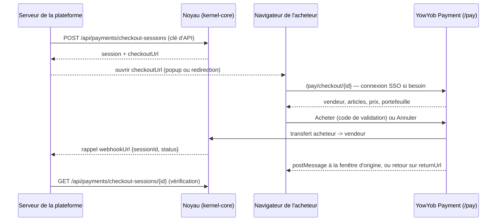

# Caisse Yowyob — intégration d'une plateforme

Toute plateforme Yowyob qui vend quelque chose (plan, article, service, billet…) fait régler l'achat
par **YowYob Payment**, ouvert en SSO. L'acheteur paie **avec son portefeuille** ; seules la recharge et
le retrait du portefeuille passent par le mobile money (MyCoolPay).



## Principes

- **Le prix est fixé par le serveur de la plateforme**, jamais par le navigateur : la session est créée
  avec la clé d'API de l'application cliente.
- **L'argent va au vendeur** : le règlement est un transfert du portefeuille de l'acheteur vers celui
  de l'organisation vendeuse. Il apparaît dans l'historique des deux.
- **Une plateforme est une place de marché** : elle n'appartient à personne et vend les produits de
  nombreuses organisations et agences. Elle désigne le vendeur à chaque achat ; l'argent va toujours
  à ce vendeur, jamais à la plateforme, et l'acheteur voit son nom avant de payer.
- **Une session ne se règle qu'une fois** ; elle expire au bout de **30 minutes**.
- **Ne livrez qu'après vérification** : le rappel et le message navigateur ne sont pas signés ; relisez
  la session avec votre clé avant de livrer.

## 1. Créer la session (serveur à serveur)

```http
POST https://kernel-core.yowyob.com/api/payments/checkout-sessions
X-Client-Id: <client id de votre application>
X-Api-Key:   <clé de votre application>
X-Tenant-Id: <tenant>
Content-Type: application/json

{
  "merchantOrganizationId": "11111111-1111-1111-1111-111111111111",
  "merchantAgencyId": "22222222-2222-2222-2222-222222222222",
  "items": [
    { "label": "Leçon de conduite", "description": "1 h", "quantity": 2, "unitAmount": 1500 },
    { "label": "Livret", "quantity": 1, "unitAmount": 500 }
  ],
  "currency": "XAF",
  "reference": "CMD-2026-001",
  "returnUrl": "https://app.exemple.com/commande/CMD-2026-001",
  "webhookUrl": "https://api.exemple.com/yowyob/checkout"
}
```

| Champ | Obligatoire | Règle |
|---|---|---|
| `merchantOrganizationId` | oui | Organisation à qui appartient le produit et qui encaisse (son portefeuille est crédité). Toute application validée peut désigner n'importe quelle organisation du tenant. |
| `merchantAgencyId` | non | Agence de cette organisation qui vend le produit. Elle doit appartenir à l'organisation ; elle est affichée à l'acheteur. L'argent reste versé au portefeuille de l'organisation. |
| `items` | oui | 1 à 50 lignes ; `quantity` 1 à 10 000 ; `unitAmount` > 0, deux décimales au plus. Le total est calculé par le noyau. |
| `currency` | non | `XAF`, seule devise acceptée (les portefeuilles sont en XAF, sans conversion). |
| `reference` | non | Votre numéro de commande. **Idempotent** : la même référence renvoie la même session (refus si elle désigne un autre achat). Une session annulée ou expirée le reste : pour proposer à nouveau l'achat, utilisez une **nouvelle** référence. |
| `returnUrl` | non | Adresse **https** publique où renvoyer l'acheteur ; son origine reçoit le `postMessage`. |
| `webhookUrl` | non | Adresse **https** publique (nom de domaine, pas d'IP ni de réseau interne) avertie à la fin. |

Réponse `201` :

```json
{
  "success": true,
  "data": {
    "session": { "id": "…", "status": "OPEN", "amount": 3500, "currency": "XAF", "expiresAt": "…" },
    "checkoutUrl": "https://kernel-core.yowyob.com/pay/checkout/…"
  }
}
```

## 2. Ouvrir la caisse

En popup :

```javascript
const popup = window.open(checkoutUrl, "yowyob-pay", "width=480,height=760");

window.addEventListener("message", (event) => {
  if (event.origin !== "https://kernel-core.yowyob.com") return;
  if (event.data?.type !== "yowyob-checkout") return;
  // { type, sessionId, status: "PAID" | "CANCELLED" | "EXPIRED", reference }
  // Prévenez votre serveur, qui VÉRIFIE la session (section 4) avant de livrer.
});
```

Ou en redirection : `window.location.assign(checkoutUrl)`. À la fin, l'acheteur revient sur
`returnUrl?checkout={id}&status={PAID|CANCELLED|EXPIRED}`.

Si l'acheteur n'est pas connecté sur YowYob Payment, il se connecte (SSO, MFA), choisit son espace,
puis revient directement sur l'achat. Il doit se connecter dans le **même tenant** que celui de la
session (`X-Tenant-Id` à la création) ; sinon l'achat lui apparaît introuvable.

## 3. Ce que voit l'acheteur

Le vendeur, les articles, le total, l'échéance, et le choix du portefeuille (personnel, ou celui de
son organisation s'il en est administrateur) avec son solde. Il **achète** — un code de validation lui
est envoyé, puis le montant est transféré au vendeur — ou il **annule**. Solde insuffisant : il
recharge son portefeuille (mobile money) puis revient régler.

## 4. Être averti et vérifier

Rappel envoyé à `webhookUrl` (trois tentatives) :

```json
{ "event": "checkout.session.paid", "sessionId": "…", "status": "PAID", "reference": "CMD-2026-001", "occurredAt": "…" }
```

Événements : `checkout.session.paid`, `checkout.session.cancelled`. Avant de livrer, **relisez** :

```http
GET https://kernel-core.yowyob.com/api/payments/checkout-sessions/{id}
X-Client-Id / X-Api-Key / X-Tenant-Id
```

Ne livrez que si `status` vaut `PAID` et que `amount`, `currency`, `reference` et
`merchantOrganizationId` (et `merchantAgencyId` le cas échéant) sont ceux attendus.
Seule l'application qui a créé la session peut la relire.

## Erreurs

| Code | HTTP | Sens |
|---|---|---|
| — | 401 | Clé d'application absente, invalide, ou application pas encore validée. |
| `CHECKOUT_INVALID` | 400 | Requête invalide (articles, montants, devise autre que XAF, adresses, agence hors de l'organisation). |
| `CHECKOUT_NOT_FOUND` | 404 | Session inconnue (ou d'un autre tenant / d'une autre application). |
| `CHECKOUT_CLOSED` | 409 | Session déjà réglée, annulée ou expirée. |
| `PAYMENT_INSUFFICIENT_BALANCE` | 422 | Solde insuffisant (côté acheteur). |
